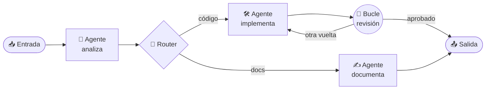

<div align="center">


# Orquestador

**Diseña equipos de agentes de IA como un diagrama y míralos trabajar en tiempo real.**

[](https://github.com/Fixerfox/Fox_agents_orchestrator/releases/latest)
[](LICENSE)


[](https://github.com/Fixerfox/Fox_agents_orchestrator/actions/workflows/check.yml)

</div>

---

## ⬇️ Descargar

<div align="center">

[](https://github.com/Fixerfox/Fox_agents_orchestrator/releases/latest/download/Orquestador-Windows-x64.exe)
[](https://github.com/Fixerfox/Fox_agents_orchestrator/releases/latest/download/Orquestador-Linux-x86_64.AppImage)
[](https://github.com/Fixerfox/Fox_agents_orchestrator/releases/latest/download/Orquestador-macOS-arm64.dmg)
[](https://github.com/Fixerfox/Fox_agents_orchestrator/releases/latest/download/Orquestador-macOS-x64.dmg)

</div>

Los instaladores llevan dentro Claude Code: **no hace falta Node ni instalar nada más**. Solo necesitas tu cuenta de Claude (sesión de Claude Code) o una clave API.

<details>
<summary><b>🪟 Windows</b></summary>

Ejecuta `Orquestador-Windows-x64.exe` y elige la carpeta. Mientras la app no esté firmada, SmartScreen avisa: pulsa **«Más información» → «Ejecutar de todas formas»**.
</details>

<details>
<summary><b>🐧 Linux</b></summary>

```bash
chmod +x Orquestador-Linux-x86_64.AppImage
./Orquestador-Linux-x86_64.AppImage
```
En Ubuntu 24.04 o posterior, si no arranca por el *sandbox* del sistema, añade `--no-sandbox`.
</details>

<details>
<summary><b>🍎 macOS</b></summary>

Abre el `.dmg` y arrastra **Orquestador** a Aplicaciones. Mientras no esté firmada por Apple, la primera vez ejecuta en la Terminal:
```bash
xattr -cr /Applications/Orquestador.app
```
</details>

---

## ✨ Qué hace

| | |
|---|---|
| 🧩 **Diagramas de agentes** | Cada nodo es un agente; cada flecha, el camino de las tareas y el contexto. Entradas, salidas, routers, bucles y subdiagramas reutilizables. |
| 👀 **En vivo** | Ves qué nodo trabaja, qué ruta se toma y la conversación de cada agente mientras ocurre. Pausa, reanuda o cancela cuando quieras. |
| 🧠 **Agentes de Claude Code** | Agentes, skills, contextos, modelo y servidores MCP por agente, en el formato nativo de Claude Code. Globales o por proyecto. |
| 🔀 **En paralelo y aislados** | Varios agentes a la vez, cada uno en su espacio de trabajo, con fusión de cambios e instantánea por vuelta en los bucles. |
| 💬 **Te preguntan** | Si un agente necesita algo, su nodo queda esperando y le respondes chateando en el propio nodo. |
| 🛡️ **Con control** | Niveles de permiso, pantalla de confianza por proyecto, límite de presupuesto y un supervisor que comprueba cada paso. |
| 📜 **Todo registrado** | Qué recibe, qué hace y qué responde cada agente, con tokens y coste, y los secretos ocultos. |
| 🤖 **Asistente integrado** | Te ayuda a crear agentes, skills y flujos desde la propia app, con pestañas por tarea. |

---

## 🗺️ Cómo funciona



La interfaz solo escucha **eventos** (`node.started`, `tool.called`, `route.decided`, `node.finished`…) que emite el orquestador. Así el motor de agentes se puede cambiar sin tocar la interfaz.

---

## 🛠️ Desarrollo

Requiere **Node.js 22** o superior.

```bash
npm install            # dependencias
npm run start:desktop  # compila y abre la app
npm run check          # tipos + lint + tests + trazabilidad spec → test
npm run dist           # instalador del sistema actual en release/dist
```

En Windows también vale con doble clic en `iniciar.bat`.

| Pieza | Qué es |
|---|---|
| ⚡ **Stack** | TypeScript · Electron · React · React Flow · Claude Agent SDK |
| 🧱 **Arquitectura** | Hexagonal: `core` (dominio y puertos), `runtime`, `claude`, `store`, `workspace`, `editor`, `ui` y `apps/desktop` |
| 📐 **Specs primero** | Cada función nace de una spec en [`specs/`](specs/README.md) con requisitos numerados que citan los tests |
| ✅ **Tests** | Vitest, más de 2.200 tests y cada requisito cubierto (`npm run spec:check`) |

📚 Documentación: [visión](docs/01-vision.md) · [arquitectura](docs/02-arquitectura.md) · [dominio](docs/03-modelo-dominio.md) · [eventos](docs/04-eventos.md) · [tests](docs/05-tests.md) · [contextos](docs/06-contextos.md) · [roadmap](docs/06-roadmap.md) · [modo prueba](docs/07-modo-prueba.md) · [reglas del proyecto](CLAUDE.md)

### 🚀 Publicar una versión

1. Sube la versión en [`apps/desktop/package.json`](apps/desktop/package.json).
2. Fusiona en `main` y crea la etiqueta: `git tag v0.9.0 && git push origin v0.9.0`.
3. El flujo [`release`](.github/workflows/release.yml) construye Windows, Linux y macOS, los prueba y publica la release. Los enlaces de arriba apuntan siempre a la última.

Una etiqueta con guion (`v0.9.0-rc.1`) se publica como *pre-release* y no cambia esos enlaces.

---

<div align="center">

**Licencia [MIT](LICENSE)** © Nicolas Corta Avila · Avisos de terceros en `THIRD_PARTY_NOTICES.txt`, junto a cada release

</div>
